# Mermaid 圖種相容性檢查

本頁依 [Mermaid 官方圖種清單](https://mermaid.js.org/ecosystem/integrations-community.html) 列出 31 種圖，供目前的 md-reader 與未來升級比較。範例為本專案依官方語法撰寫，沒有使用遠端圖示或字型。

目前使用 Mermaid **9.1.6**。此頁刻意包含尚未支援的語法，因此部分圖會顯示錯誤或 `undefined`；這些不能視為風格驗收通過。兩種風格的逐項結果與永久測試方式見 [相容性測試報告](../docs/research/mermaid-diagram-compatibility.md)。純視覺比較請使用 [Mermaid 風格檢查頁](mermaid-styles.md)。

在「設定 → 插件 → Mermaid 風格」切換 **Original** 與 **Anthropic blog style**。

## 1. Flowchart

[官方語法](https://mermaid.js.org/syntax/flowchart.html)

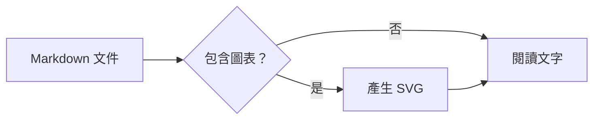

## 2. Swimlanes Diagram

[官方語法](https://mermaid.js.org/syntax/swimlanes.html)

```mermaid
swimlane-beta LR
    subgraph Reader
        Open[Open document]
    end
    subgraph Extension
        Parse[Parse Markdown]
        Draw[Render diagram]
    end
    Open --> Parse
    Parse --> Draw
```

## 3. Sequence Diagram

[官方語法](https://mermaid.js.org/syntax/sequenceDiagram.html)

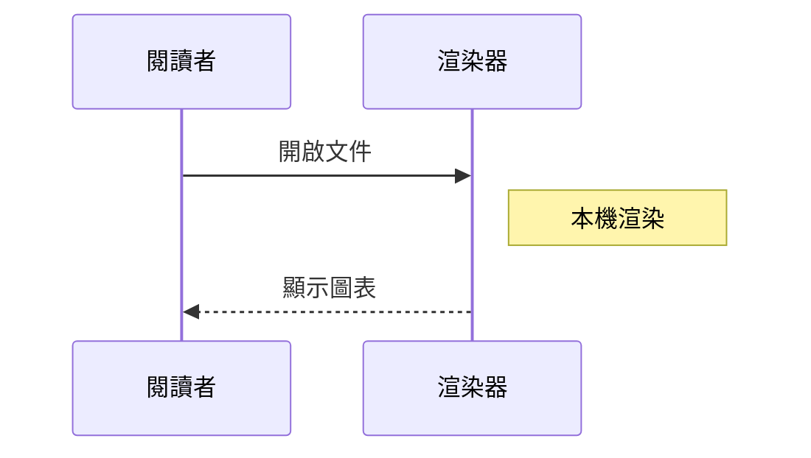

## 4. Class Diagram

[官方語法](https://mermaid.js.org/syntax/classDiagram.html)

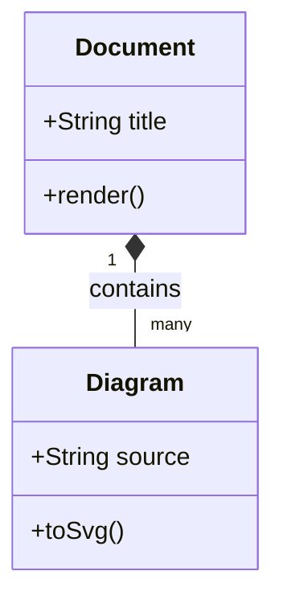

## 5. State Diagram

[官方語法](https://mermaid.js.org/syntax/stateDiagram.html)

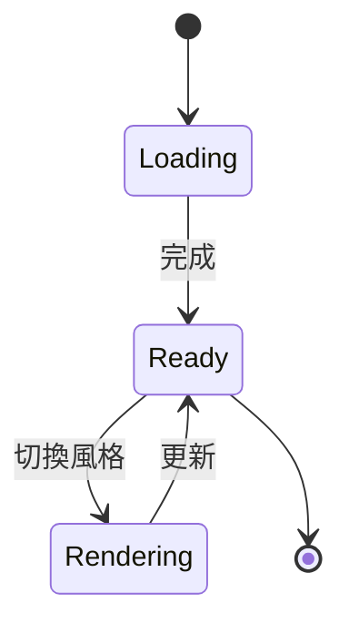

## 6. Entity Relationship Diagram

[官方語法](https://mermaid.js.org/syntax/entityRelationshipDiagram.html)

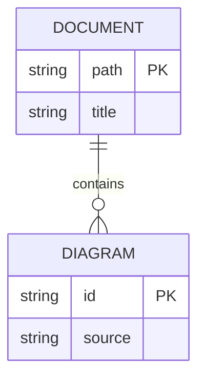

## 7. User Journey

[官方語法](https://mermaid.js.org/syntax/userJourney.html)

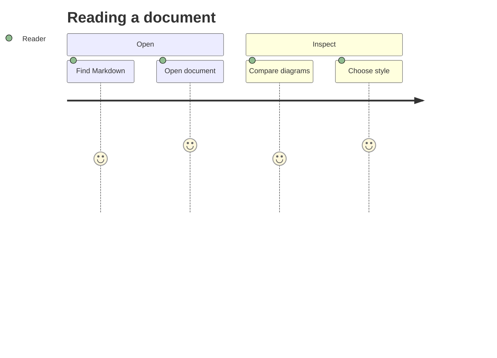

## 8. Gantt

[官方語法](https://mermaid.js.org/syntax/gantt.html)

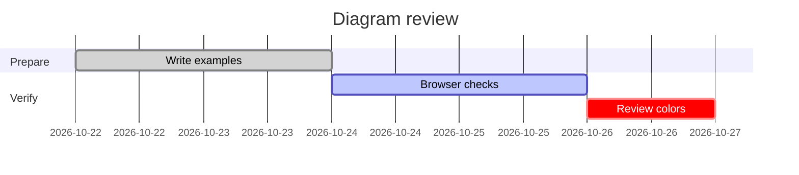

## 9. Pie Chart

[官方語法](https://mermaid.js.org/syntax/pie.html)

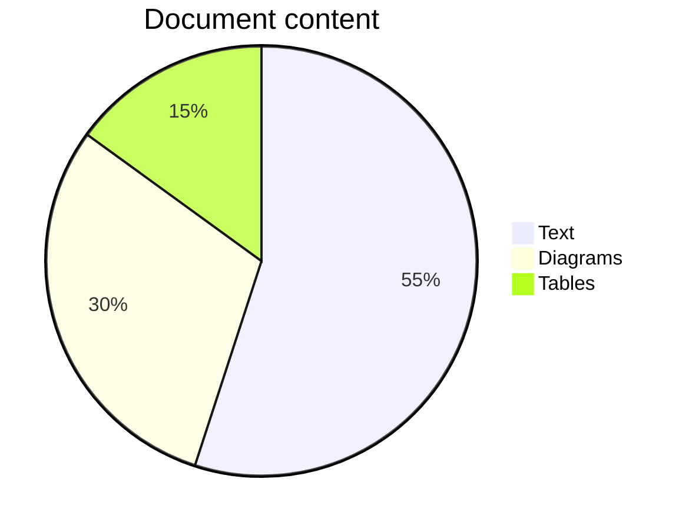

## 10. Quadrant Chart

[官方語法](https://mermaid.js.org/syntax/quadrantChart.html)

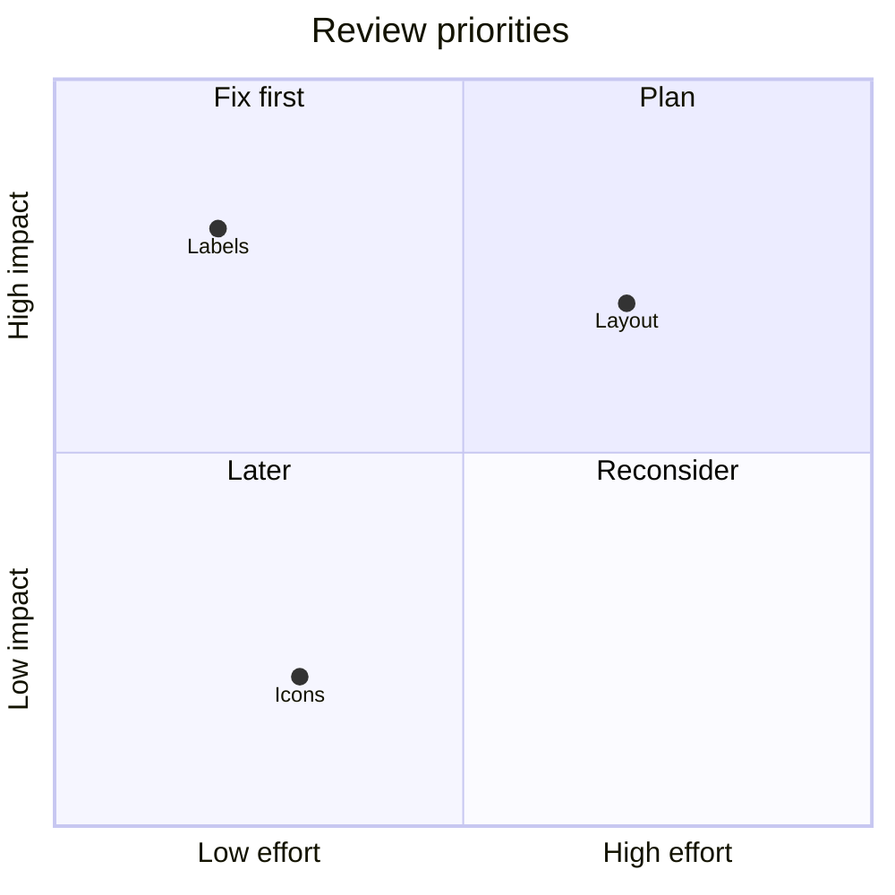

## 11. Requirement Diagram

[官方語法](https://mermaid.js.org/syntax/requirementDiagram.html)

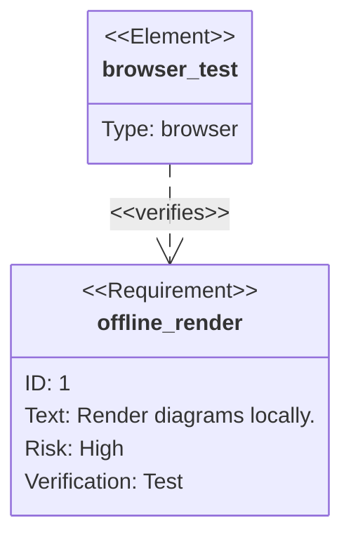

## 12. Use Case Diagram

[官方語法](https://mermaid.js.org/syntax/usecase.html)

```mermaid
usecase-beta
direction LR
actor Reader
systemBoundary Extension
    Open("Open Markdown")
    Inspect("Inspect diagrams")
end
Reader --> Open
Reader --> Inspect
```

## 13. GitGraph (Git) Diagram

[官方語法](https://mermaid.js.org/syntax/gitgraph.html)

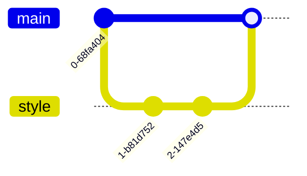

## 14. C4 Diagram

[官方語法](https://mermaid.js.org/syntax/c4.html)

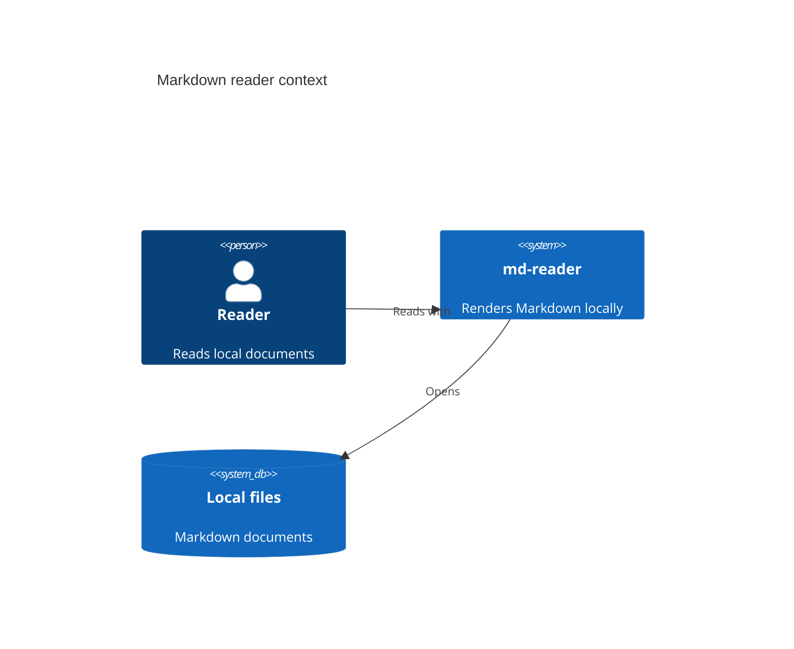

## 15. Mindmaps

[官方語法](https://mermaid.js.org/syntax/mindmap.html)

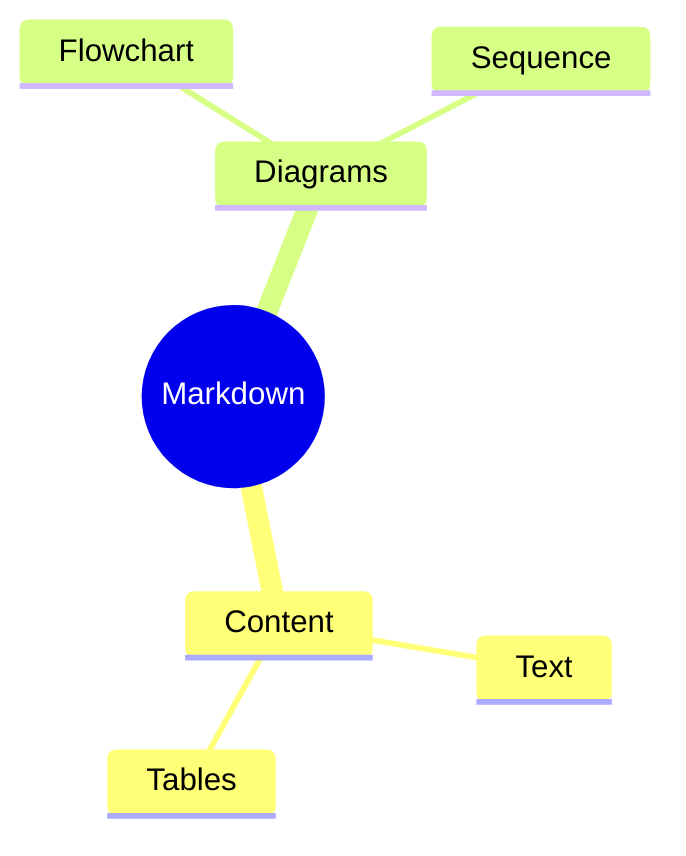

## 16. Timeline

[官方語法](https://mermaid.js.org/syntax/timeline.html)

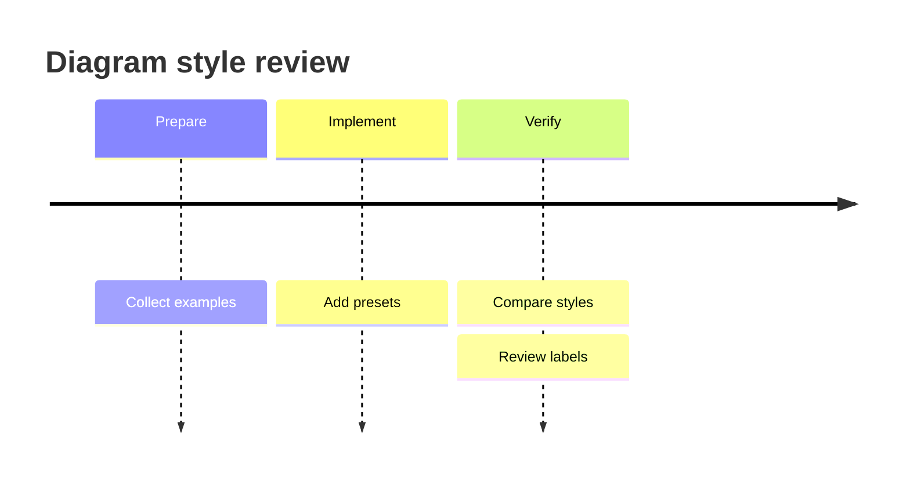

## 17. ZenUML

[官方語法與額外套件註冊](https://mermaid.js.org/syntax/zenuml.html#integrating-with-your-library-website)

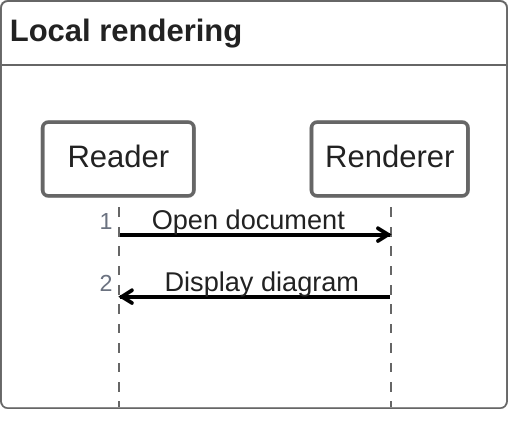

## 18. Sankey

[官方語法](https://mermaid.js.org/syntax/sankey.html)

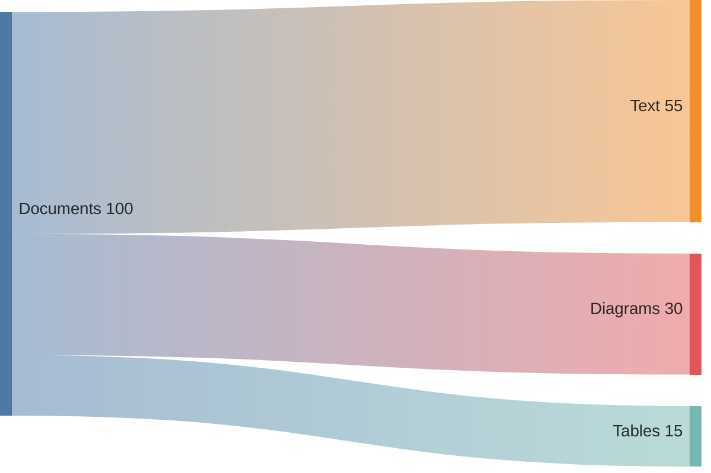

## 19. XY Chart

[官方語法](https://mermaid.js.org/syntax/xyChart.html)

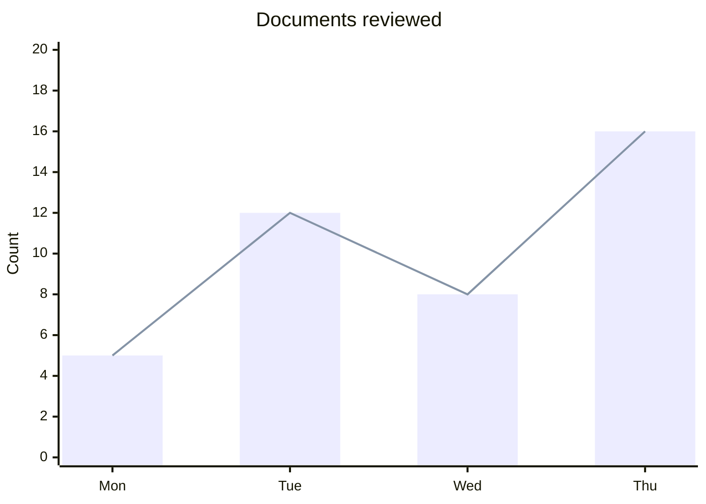

## 20. Block Diagram

[官方語法](https://mermaid.js.org/syntax/block.html)

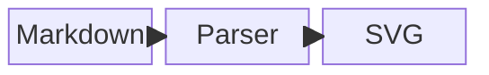

## 21. Packet

[官方語法](https://mermaid.js.org/syntax/packet.html)

```mermaid
packet
    0-7: "Type"
    8-15: "Flags"
    16-31: "Length"
```

## 22. Kanban

[官方語法](https://mermaid.js.org/syntax/kanban.html)

```mermaid
kanban
    todo[To do]
        labels[Review labels]
    reviewing[Reviewing]
        colors[Compare colors]
    done[Done]
        fixtures[Write examples]
```

## 23. Architecture

[官方語法](https://mermaid.js.org/syntax/architecture.html)

```mermaid
architecture-beta
    group local(cloud)[Local browser]
    service files(disk)[Markdown] in local
    service renderer(server)[Renderer] in local
    files:R -- L:renderer
```

## 24. Radar

[官方語法](https://mermaid.js.org/syntax/radar.html)

```mermaid
radar-beta
    axis labels["Labels"], contrast["Contrast"], layout["Layout"]
    curve original["Original"]{4, 3, 4}
    curve editorial["Anthropic"]{4, 5, 3}
    min 0
    max 5
```

## 25. Event Modeling

[官方語法](https://mermaid.js.org/syntax/eventmodeling.html)

```mermaid
eventmodeling
    tf 01 ui DocumentView
    tf 02 cmd ChangeStyle
    tf 03 evt StyleChanged
```

## 26. Treemap

[官方語法](https://mermaid.js.org/syntax/treemap.html)

```mermaid
treemap-beta
"Documents"
    "Guides": 12
    "Examples": 8
"Tests"
    "Unit": 15
    "Browser": 10
```

## 27. Venn

[官方語法](https://mermaid.js.org/syntax/venn.html)

```mermaid
venn-beta
    title Diagram acceptance
    set Readable
    set Correct
    set Offline
    union Readable,Correct["Reviewable"]
    union Readable,Correct,Offline["Ready"]
```

## 28. Ishikawa

[官方語法](https://mermaid.js.org/syntax/ishikawa.html)

```mermaid
ishikawa-beta
    Unreadable diagram
    Labels
        Small text
        Long names
    Colors
        Low contrast
    Layout
        Overlapping nodes
```

## 29. Wardley

[官方語法](https://mermaid.js.org/syntax/wardley.html)

```mermaid
wardley-beta
title Markdown reading
anchor Reader [0.95, 0.40]
component Document [0.75, 0.45]
component Renderer [0.40, 0.65]
Reader -> Document
Document -> Renderer
```

## 30. Cynefin

[官方語法](https://mermaid.js.org/syntax/cynefin.html)

```mermaid
cynefin-beta
    title Diagram maintenance
    clear
        "Update examples"
    complicated
        "Review parser behavior"
    complex
        "Explore new layouts"
    chaotic
        "Restore broken rendering"
    confusion
        "Classify issue"
```

## 31. TreeView

[官方語法](https://mermaid.js.org/syntax/treeView.html)

```mermaid
treeView-beta
    md-reader/
        src/
            core/
                markdown.ts
        example/
            mermaid-styles.md
        package.json
```
