# Mermaid 風格檢查頁

在「設定 → 插件 → Mermaid 風格」切換 **Original** 與 **Anthropic blog style**，比較同一份圖表。也可以搭配 Developer、Editorial 或關閉 CSS 客製化，並切換頁面亮暗主題。

前十一節沒有指定配色，應隨選單切換。第 12、13 節刻意指定作者配色與主題，應保留作者的設定；第 14 節則確認主題不會延續到下一張圖。

## 1. 流程圖

檢查一般節點、判斷分支、連線標籤與圓角。

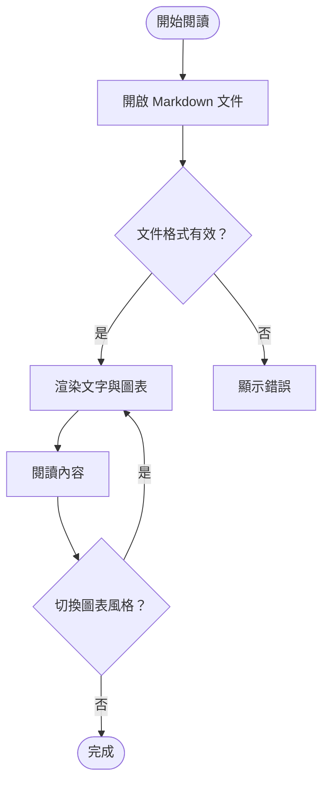

## 2. 時序圖

檢查角色、訊息、虛線回應、註記與分組框。

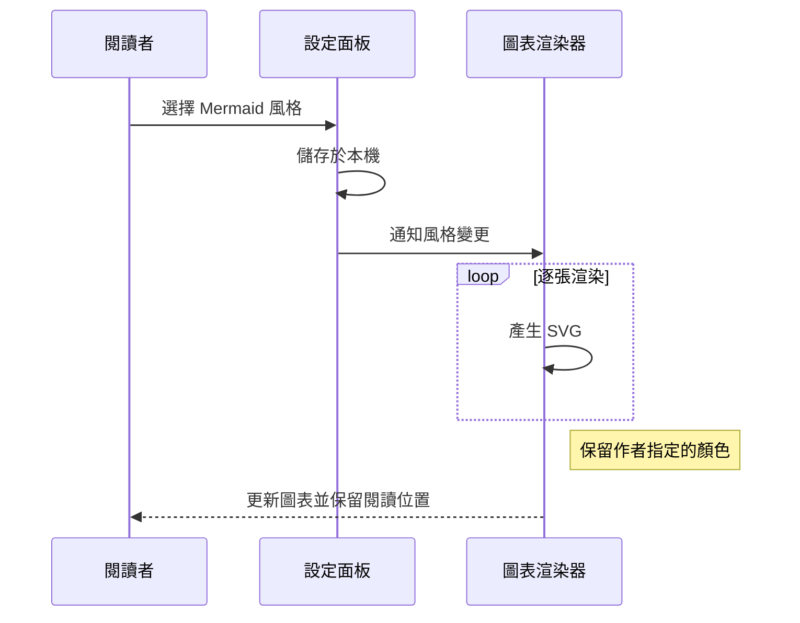

## 3. 類別圖

檢查類別標題、屬性、方法與關聯箭頭。

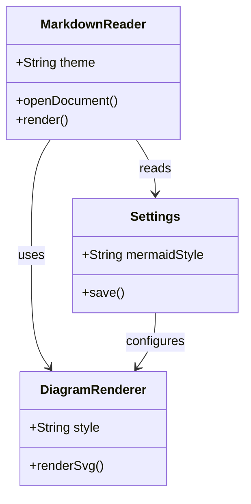

## 4. 狀態圖

檢查起點、終點、狀態節點與轉移文字。

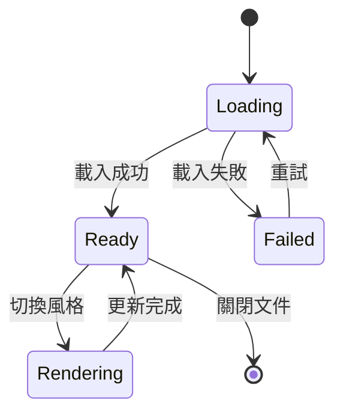

## 5. ER 關聯圖

檢查實體表格、欄位、關聯符號與連線文字。

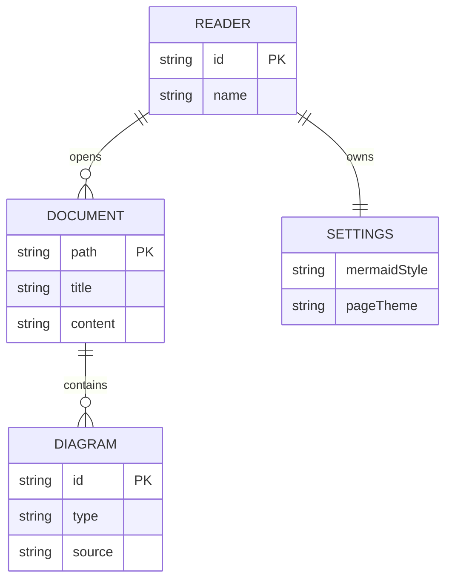

## 6. 甘特圖

檢查時間軸、階段背景、一般任務、進行中任務與重要任務。日期為固定範例。

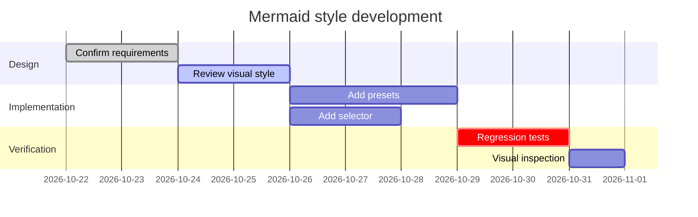

## 7. 圓餅圖

檢查不同分類的配色、百分比、標題與圖例對比。

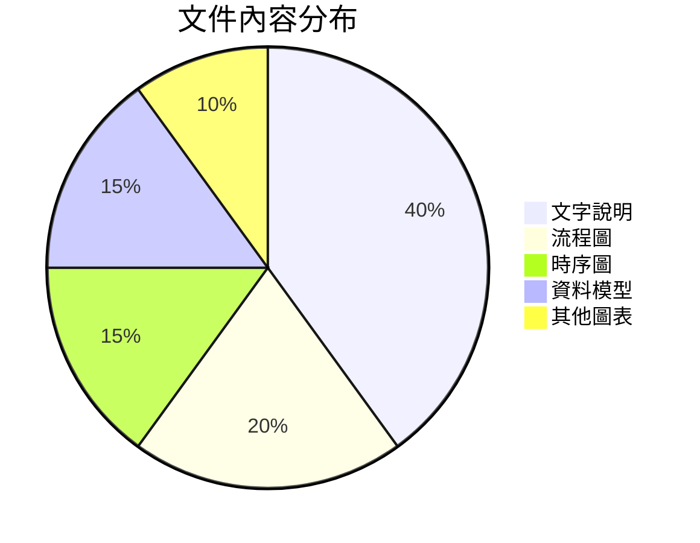

## 8. Git 分支圖

檢查不同分支的顏色、分支標籤、提交節點與合併線。縮窄視窗時，確認初始畫面完整，也能縮放與拖曳。

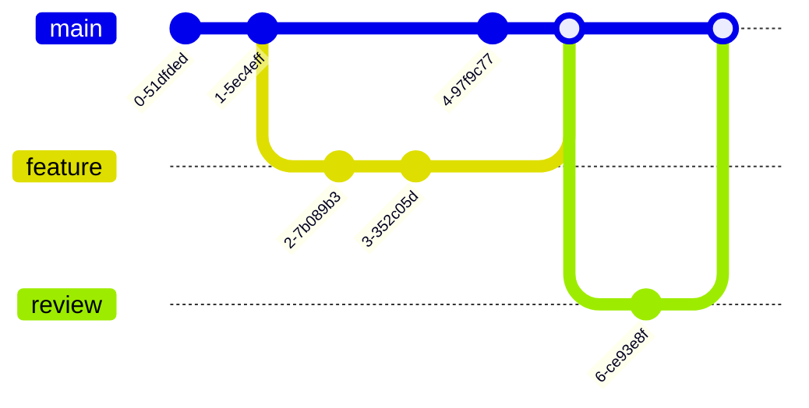

## 9. 使用者旅程

檢查階段、活動、角色、分數與表情符號。

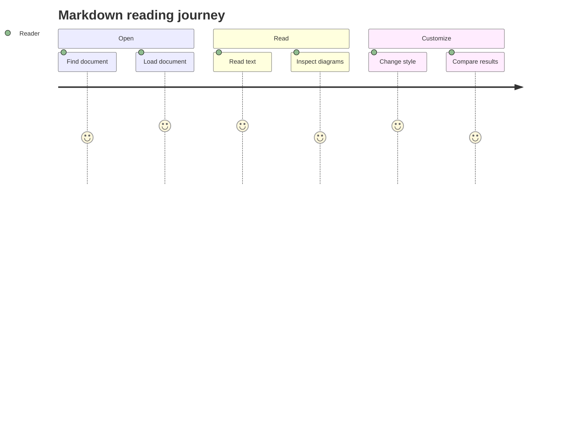

## 10. 節點形狀

一般矩形可以柔化圓角；圓角矩形、膠囊形、菱形、圓形與資料庫形狀仍應保留各自的形狀。

## 11. 中文長標籤與寬圖

檢查繁體中文、英文混排與連線文字。視窗較窄時，可使用圖表的縮放與拖曳控制查看細節。

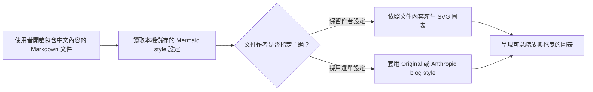

## 12. 作者自訂配色

這張圖的紅色錯誤節點、藍色重試節點與綠色連線，在兩種風格下都應保留。未指定配色的「完成」節點仍可跟隨選單風格。

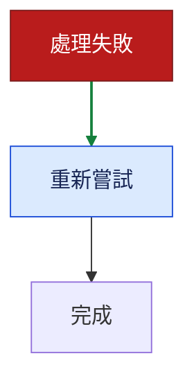

## 13. 作者指定 Forest 主題

這張時序圖明確指定 `forest`，角色與文字應保留作者主題，不被 Anthropic preset 的配色或字型覆蓋。

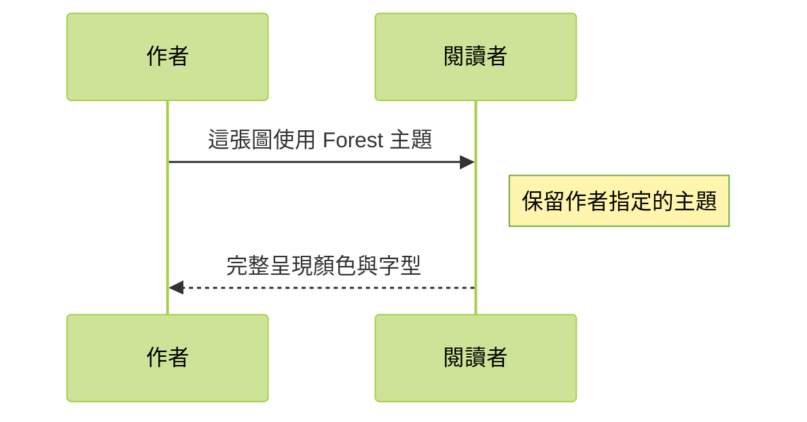

## 14. 回到選單風格

前一張圖的 Forest 設定不應延續到這張圖；這裡應重新使用選單目前選擇的風格。

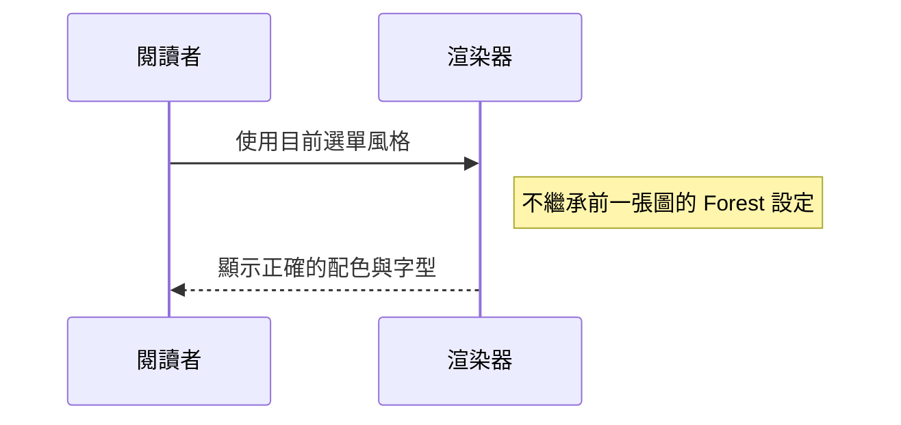
